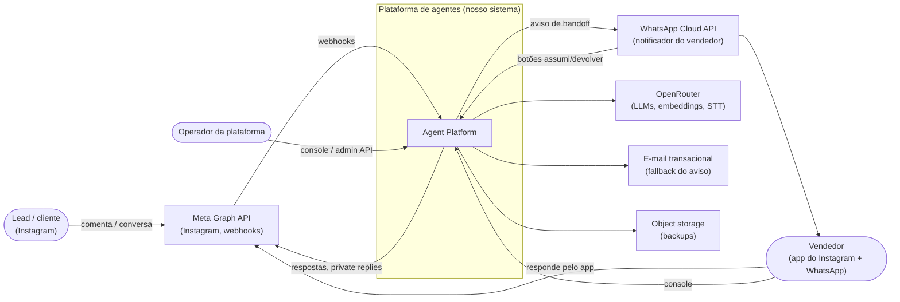
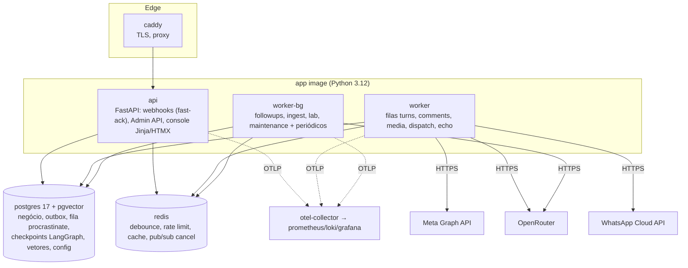
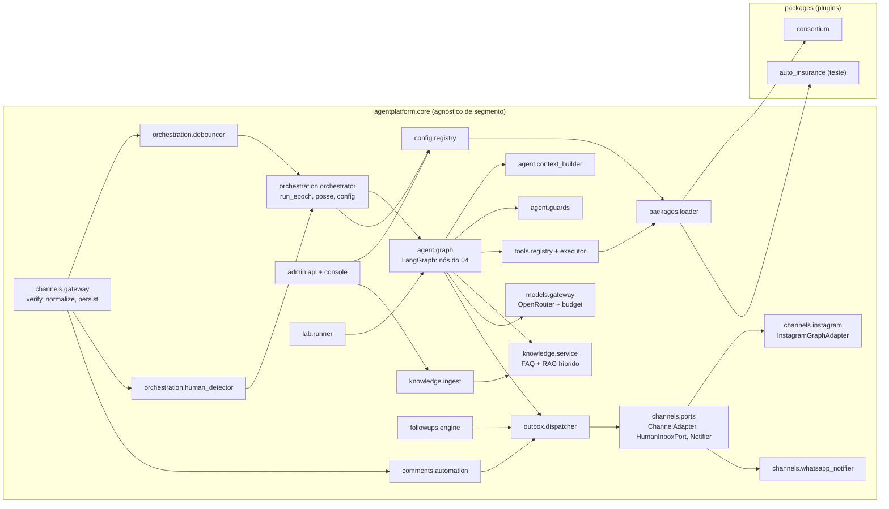
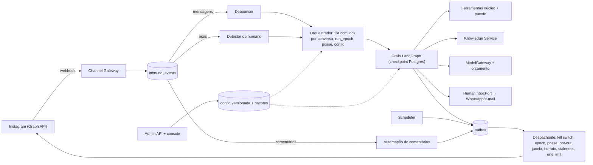

# 02 — Arquitetura

Mensagens entram por adaptadores de canal, viram eventos canônicos persistidos, passam por debounce e por execução serializada por conversa, rodam o grafo do agente e saem **só** pelo outbox, cujo despachante checa posse, janela, horário e limites antes de cada envio.

## 1. C4 — Contexto

## 2. C4 — Containers

## 3. C4 — Componentes (dentro da imagem `app`)

## 4. Fluxo de referência

## 5. Desvios em relação à arquitetura de referência do prompt

| Ponto | Referência | Este plano | Por quê | ADR |
| --- | --- | --- | --- | --- |
| `understand_turn` + `classify_stage` | Dois nós paralelos | Um nó `analyze_turn` com duas saídas (modo `merged`); `parallel` disponível por config | Orçamento e latência; o laboratório decide | ADR-017 |
| Fila | Em aberto | procrastinate (Postgres), com `lock=conversation_id` | Serialização por chave nativa, zero RAM extra, durável | ADR-004 |
| Lock | TTL + fencing (Redis) ou advisory | Fila serializada + `run_epoch` como fencing no Postgres + `pg_advisory_xact_lock` no commit | Correção sem depender do Redis | ADR-005 |
| Tracing | Langfuse (Cloud ou self-hosted) ou OTel | OTel + tabelas no Postgres; Langfuse Cloud opcional com amostragem | Self-hosted pede 16 GiB; Cloud Hobby não cobre o volume sem amostragem | ADR-007 |
| Notificador | Telegram, e-mail ou outro | WhatsApp Cloud API (decisão do usuário) + e-mail de fallback | Decisão do usuário | ADR-010 |
| Login Meta | Instagram Login (token de 60 dias) | Facebook Login (Page token sem expiração fixa) | Situação real do app | ADR-001 |
| Console | Não especificado | FastAPI + Jinja2 + HTMX (sem SPA) | Mantém uma linguagem só; evita ADR de TypeScript | ADR-003 |

## 6. Escala

- **100 → 1.000 conversas/dia:** `--scale worker=3`, Postgres com mais memória; nenhuma mudança de código (fila particionada por conversa, sem estado em memória).
- **Mais tenants:** RLS + config por tenant; filas compartilhadas com fairness por tenant (`priority` + limite de concorrência por tenant no orquestrador).
- **Mais canais:** novo `ChannelAdapter` + novos tipos de evento canônico, se preciso.
- **Pontos de atenção:** Postgres como fila + dados + vetores na mesma instância. Gatilho para separar: `queue_lag` p95 > 5 s com CPU do Postgres > 70% → réplica de leitura para busca vetorial ou Postgres dedicado à fila.
