# 03 — Modelo de dados

PostgreSQL é a fonte da verdade. Redis guarda só o que pode ser reconstruído a partir do Postgres. Todo identificador, tabela e coluna está em inglês. O DDL abaixo é um **rascunho que fixa decisões**; as migrações reais saem dele (Alembic) na fase 1.

## 1. Convenções

- PK `id uuid` (UUIDv7, gerado na aplicação, ordenável no tempo), exceto em tabelas de log de alto volume.
- `tenant_id uuid not null` em **toda** tabela de negócio, com RLS (seção 7).
- `created_at timestamptz not null default now()`; tudo em UTC; o fuso do tenant fica na config.
- Enums como `text` + `CHECK` (mudar valor não exige migração de tipo).
- Campos pessoais sensíveis (telefone, e-mail, nome completo) cifrados na aplicação (`bytea`, AES-GCM com chave por tenant via envelope; ADR-016), com coluna `*_hash` (HMAC-SHA256 com pepper) para busca e deduplicação.
- Nenhuma tabela do núcleo tem coluna específica de segmento: dados do segmento ficam em `jsonb` validado pelo schema do pacote (`13`).

## 2. Diagrama ER (núcleo)

```mermaid
erDiagram
  tenants ||--o{ channel_accounts : has
  tenants ||--o{ tenant_users : has
  tenants ||--o{ config_versions : has
  contacts ||--o{ contact_identities : has
  contacts ||--o{ conversations : has
  channel_accounts ||--o{ conversations : carries
  conversations ||--o{ messages : has
  conversations ||--o{ turns : has
  conversations ||--o{ ownership_events : has
  conversations ||--o{ outbox : has
  turns ||--o{ llm_calls : has
  turns ||--o{ tool_calls : has
  turns ||--o{ guard_results : has
  contacts ||--|| leads : "is (per tenant)"
  leads ||--o{ lead_stage_history : has
  leads ||--o{ lead_sources : has
  leads ||--o{ lead_forms : has
  leads ||--o{ handoffs : has
  contacts ||--o{ consents : has
  conversations ||--o{ followup_runs : has
  channel_accounts ||--o{ comment_rules : has
  comment_rules ||--o{ comment_actions : triggers
  inbound_events ||--o| messages : "becomes"
  kb_sources ||--o{ kb_documents : has
  kb_documents ||--o{ kb_chunks : has
  kb_indexes ||--o{ kb_chunks : contains
  faqs ||--o{ faq_variants : has
```



## 3. DDL — rascunho

```sql
-- ===== Tenancy, users, config =====
create table tenants (
  id uuid primary key,
  slug text unique not null,
  display_name text not null,
  timezone text not null default 'America/Sao_Paulo',
  segment_package text not null,          -- e.g. 'consortium'
  segment_package_version text not null,  -- semver
  status text not null check (status in ('active','paused','offboarded')),
  created_at timestamptz not null default now()
);

create table tenant_users (
  id uuid primary key,
  tenant_id uuid references tenants(id),  -- null = platform admin
  email_hash bytea not null,
  email_enc bytea not null,
  role text not null check (role in ('platform_admin','tenant_owner','seller','reviewer')),
  notify_whatsapp_enc bytea,              -- seller's phone for handoff alerts (opt-in recorded in consents)
  is_active boolean not null default true,
  created_at timestamptz not null default now()
);

create table config_versions (
  id uuid primary key,
  tenant_id uuid references tenants(id),  -- null = platform default
  env text not null check (env in ('dev','staging','prod')),
  version int not null,
  document jsonb not null,                -- validated by PlatformConfig (08)
  content_hash text not null,
  status text not null check (status in ('draft','approved','canary','active','superseded','rolled_back')),
  canary_percent int not null default 0 check (canary_percent between 0 and 100),
  eval_run_id uuid,                       -- run that approved it (10)
  created_by uuid not null, approved_by uuid[], created_at timestamptz not null default now(),
  unique (tenant_id, env, version)
);

create table kill_switches (
  id uuid primary key,
  scope text not null check (scope in ('global','channel','tenant','campaign','feature')),
  scope_ref text,                          -- e.g. 'instagram', tenant id, feature name
  is_on boolean not null,                  -- on = blocked
  reason text not null, changed_by uuid not null, changed_at timestamptz not null default now()
);

-- ===== Channels =====
create table channel_accounts (
  id uuid primary key,
  tenant_id uuid not null references tenants(id),
  channel text not null,                   -- 'instagram' | 'whatsapp' | 'webchat' ...
  external_account_id text not null,       -- IG professional account id
  external_page_id text,                   -- FB page id (Facebook Login)
  token_enc bytea not null,                -- envelope-encrypted (ADR-016)
  token_kind text not null,                -- 'page' | 'user_long_lived' | 'system_user'
  token_expires_at timestamptz,            -- null = non-expiring page token (still validated daily)
  token_last_validated_at timestamptz,
  token_status text not null check (token_status in ('valid','expiring','invalid','revoked')),
  scopes text[] not null,
  access_level text,                       -- 'standard' | 'advanced'
  rate_limit_profile text not null,
  created_at timestamptz not null default now(),
  unique (channel, external_account_id)
);

-- ===== Inbound (idempotent) =====
create table inbound_events (
  id bigint generated always as identity primary key,
  tenant_id uuid not null,
  channel_account_id uuid not null references channel_accounts(id),
  idempotency_key text not null,           -- channel:type:external_id (mid, comment id, ...)
  event_type text not null,                -- MessageReceived | CommentReceived | MessageEcho | ...
  provider_ts timestamptz not null,
  received_at timestamptz not null default now(),
  payload_raw jsonb not null,              -- PII: purged by retention job
  payload_canonical jsonb not null,
  status text not null default 'pending' check (status in ('pending','processing','done','failed','dead','ignored')),
  attempts int not null default 0,
  last_error text,
  unique (channel_account_id, idempotency_key)
);
create index on inbound_events (status, received_at) where status in ('pending','failed');

-- ===== Contacts and identity =====
create table contacts (
  id uuid primary key,
  tenant_id uuid not null,
  display_name_enc bytea,
  first_name text,                         -- only first name in clear (notifications)
  phone_hash bytea, email_hash bytea,      -- strong identifiers (confirmed only)
  phone_enc bytea, email_enc bytea,
  merged_into uuid references contacts(id),
  created_at timestamptz not null default now()
);
create unique index on contacts (tenant_id, phone_hash) where phone_hash is not null and merged_into is null;
create unique index on contacts (tenant_id, email_hash) where email_hash is not null and merged_into is null;

create table contact_identities (
  id uuid primary key,
  tenant_id uuid not null,
  contact_id uuid not null references contacts(id),
  channel text not null,
  external_user_id text not null,          -- IGSID (scoped id) / wa_id ...
  username text,
  unique (tenant_id, channel, external_user_id)
);

create table contact_merge_suggestions (
  id uuid primary key, tenant_id uuid not null,
  contact_a uuid not null, contact_b uuid not null,
  evidence jsonb not null, score numeric not null,
  status text not null check (status in ('pending','approved','rejected')),
  decided_by uuid, decided_at timestamptz
);

-- ===== Conversations, ownership, messages =====
create table conversations (
  id uuid primary key,
  tenant_id uuid not null,
  contact_id uuid not null references contacts(id),
  channel_account_id uuid not null references channel_accounts(id),
  thread_external_id text,
  ownership text not null default 'BOT' check (ownership in ('BOT','AWAITING_HUMAN','HUMAN','PAUSED','CLOSED')),
  ownership_changed_at timestamptz not null default now(),
  run_epoch bigint not null default 0,     -- fencing for COMMIT: bumped when an uncommitted run is cancelled (new batch, ownership change)
  send_epoch bigint not null default 0,    -- fencing for DISPATCH: bumped only by ownership change, kill switch, opt-out (review #5)
  handoff_pending boolean not null default false,  -- off-hours handoff: bot keeps serving until human hours (review #8)
  last_bot_or_human_reply_at timestamptz,  -- for "inbound without reply" metric/alert (review #9)
  last_inbound_at timestamptz,             -- customer's last message (window anchor)
  window_expires_at timestamptz,           -- channel service window (24h on IG)
  entrypoint text,                         -- 'comment_private_reply' | 'dm' | 'story_reply' | 'ad_referral' | ...
  summary text,                            -- rolling summary, no raw PII
  summary_turn_id uuid,
  created_at timestamptz not null default now(),
  unique (channel_account_id, contact_id)
);

create table ownership_events (
  id bigint generated always as identity primary key,
  tenant_id uuid not null, conversation_id uuid not null,
  from_state text not null, to_state text not null,
  cause text not null,                     -- 'echo_unknown_mid' | 'handoff' | 'console_take' | 'notifier_button' | 'return_to_bot' | 'kill_switch' | ...
  actor uuid, evidence jsonb, at timestamptz not null default now()
);

create table messages (
  id uuid primary key,
  tenant_id uuid not null, conversation_id uuid not null,
  direction text not null check (direction in ('in','out_bot','out_human','out_system')),
  external_mid text,
  inbound_event_id bigint references inbound_events(id),
  kind text not null,                      -- text | audio | image | document | sticker | reaction | postback
  text_masked text,                        -- PII-masked text used by LLM and traces
  text_enc bytea,                          -- original text, encrypted
  media jsonb,                             -- {type, url_expires_at, storage_key, transcript, description}
  provider_ts timestamptz not null,
  turn_id uuid,
  created_at timestamptz not null default now()
);
create unique index on messages (conversation_id, external_mid) where external_mid is not null;
create index on messages (conversation_id, provider_ts);

-- ===== Turns, LLM, tools, guards =====
create table turns (
  id uuid primary key,
  tenant_id uuid not null, conversation_id uuid not null,
  run_epoch bigint not null,
  config_version_id uuid not null,
  input_message_ids uuid[] not null,
  status text not null check (status in ('running','committed','cancelled','failed','handoff')),
  lease_id uuid not null,                  -- commit is CAS: status='running' and lease_id=:lease (review #6)
  lease_expires_at timestamptz not null,
  procrastinate_job_id bigint,             -- recovery only through the job (stalled-job retry), never a side executor
  cancel_reason text,
  stage_before text, stage_after text,
  llm_calls int not null default 0, cost_usd numeric(12,6) not null default 0,
  started_at timestamptz not null default now(), heartbeat_at timestamptz, finished_at timestamptz,
  trace_id text
);

create table llm_calls (
  id bigint generated always as identity primary key,
  tenant_id uuid not null, turn_id uuid, node text not null,
  purpose text not null,                   -- 'turn' | 'lab' | 'ingest' | 'judge'
  model_requested text not null, model_used text, provider text,
  prompt_version text not null,
  input_tokens int, output_tokens int, cached_tokens int,
  cost_usd numeric(12,6), latency_ms int,
  status text not null,                    -- ok | timeout | error | fallback | budget_denied
  openrouter_generation_id text,
  created_at timestamptz not null default now()
);

create table tool_calls (
  id bigint generated always as identity primary key,
  tenant_id uuid not null, turn_id uuid not null, tool text not null,
  args jsonb not null, result_digest jsonb, effect_class text not null,
  status text not null, latency_ms int, idempotency_key text not null unique
);

create table guard_results (
  id bigint generated always as identity primary key,
  tenant_id uuid not null, turn_id uuid not null,
  guard text not null,                     -- input_guard | output_guard | dispatcher
  rule_id text not null, verdict text not null check (verdict in ('pass','block','rewrite','handoff')),
  detail jsonb, created_at timestamptz not null default now()
);

-- ===== Outbox (transactional) =====
create table outbox (
  id uuid primary key,
  tenant_id uuid not null, conversation_id uuid not null,
  turn_id uuid,                            -- null for comment automation/followups
  effect_key text not null unique,         -- deterministic: turn_id:bubble_idx | comment_id:action | followup_run:step
  kind text not null,                      -- dm_text | dm_media | private_reply | public_comment_reply | template | typing
  is_proactive boolean not null,           -- followup/campaign => quiet hours apply
  priority smallint not null,              -- 0 active conv, 1 comment, 2 followup, 3 campaign
  payload jsonb not null,                  -- exact approved text; NEVER re-hydrated with PII (review #3)
  content_hash text not null,              -- sha256 of the approved text; dispatcher verifies before send; echo matching
  send_epoch bigint not null,              -- must equal conversations.send_epoch at dispatch
  not_before timestamptz not null default now(),
  max_staleness_s int not null,
  status text not null default 'pending' check (status in ('pending','sending','sent','failed','cancelled','unknown')),
  attempt_registered_at timestamptz,       -- set BEFORE calling the provider (echo race, ADR-002)
  external_mid text,
  cancel_reason text,
  attempts int not null default 0, last_error text,
  sent_at timestamptz, created_at timestamptz not null default now()
);
create index on outbox (status, priority, not_before) where status in ('pending','unknown');
create index on outbox (conversation_id, status);
create unique index on outbox (external_mid) where external_mid is not null;

-- ===== Leads, funnel, attribution =====
create table leads (
  id uuid primary key,
  tenant_id uuid not null, contact_id uuid not null unique,
  stage text not null,                     -- values come from the segment package
  stage_changed_at timestamptz not null default now(),
  profile jsonb not null default '{}',     -- {slot: {value, source_message_id, confidence, at}}; validated by package schema
  is_qualified boolean not null default false,
  qualified_at timestamptz,
  opted_out_at timestamptz,
  created_at timestamptz not null default now()
);

create table lead_stage_history (
  id bigint generated always as identity primary key,
  tenant_id uuid not null, lead_id uuid not null,
  from_stage text, to_stage text not null,
  proposed_by text not null,               -- 'classifier' | 'rule' | 'seller' | 'system'
  confidence numeric, evidence jsonb, turn_id uuid,
  applied boolean not null, rejected_reason text,
  at timestamptz not null default now()
);

create table lead_sources (
  id uuid primary key, tenant_id uuid not null, lead_id uuid not null,
  channel text not null, entrypoint text not null,
  media_id text, ad_id text, campaign text, utm jsonb, comment_id text,
  is_first_touch boolean not null, at timestamptz not null default now()
);

create table lead_forms (
  id uuid primary key, tenant_id uuid not null, lead_id uuid not null,
  token_hash bytea not null unique, expires_at timestamptz not null,
  fields jsonb,                            -- encrypted values per field (package defines fields)
  consent_id uuid, submitted_at timestamptz, delivered_to_seller_at timestamptz
);

create table handoffs (
  id uuid primary key, tenant_id uuid not null, conversation_id uuid not null, lead_id uuid not null,
  reason text not null, priority text not null, summary jsonb not null,
  notified_via text, notified_at timestamptz, taken_at timestamptz, taken_by uuid,
  sla_due_at timestamptz, sla_breached boolean not null default false,
  created_at timestamptz not null default now()
);

-- ===== Consent, opt-out, suppression =====
create table consents (
  id uuid primary key, tenant_id uuid not null, contact_id uuid not null,
  purpose text not null,                   -- 'service' | 'marketing' | 'lead_form' | 'seller_alerts'
  legal_basis text not null,               -- 'consent' | 'legitimate_interest' | 'contract_preliminary' ...
  status text not null check (status in ('granted','revoked')),
  evidence jsonb not null,                 -- message id, form id, import batch, ip/ua
  channel text, at timestamptz not null default now()
);

create table suppression_list (
  tenant_id uuid not null, identifier_hash bytea not null,  -- phone/email/IGSID hash
  reason text not null, at timestamptz not null default now(),
  primary key (tenant_id, identifier_hash)
);

-- ===== Comments automation =====
create table comment_rules (
  id uuid primary key, tenant_id uuid not null, channel_account_id uuid not null,
  scope text not null check (scope in ('account','media','ad')), scope_ref text,
  trigger jsonb not null,                  -- {kind: keyword|regex|intent, ...}
  actions text[] not null,                 -- public_reply, private_reply, register_lead
  public_variants text[] not null, private_variants jsonb not null,   -- A/B weights
  priority int not null, valid_from timestamptz, valid_to timestamptz,
  is_active boolean not null default true, config_version_id uuid
);

create table comment_actions (
  id uuid primary key, tenant_id uuid not null,
  comment_id text not null, media_id text not null, author_external_id text not null,
  rule_id uuid, decision text not null,    -- acted | ignored_self | spam | human_queue | dedup_window | no_rule
  private_variant text, public_variant text,
  private_reply_outbox_id uuid, public_reply_outbox_id uuid,
  created_at timestamptz not null default now(),
  unique (tenant_id, comment_id)
);
create index on comment_actions (tenant_id, media_id, author_external_id, created_at);

-- atomic claim: at most one private reply per person and media within the window (review #11)
create table private_reply_claims (
  tenant_id uuid not null, media_id text not null, author_external_id text not null,
  claimed_at timestamptz not null, comment_id text not null,
  primary key (tenant_id, media_id, author_external_id)
);
-- insert ... on conflict (tenant_id, media_id, author_external_id)
--   do update set claimed_at = now(), comment_id = excluded.comment_id
--   where private_reply_claims.claimed_at < now() - :window
-- returning comment_id;   -- no row returned => already claimed inside the window

-- ===== Follow-ups (and campaigns, phase 4) =====
create table followup_runs (
  id uuid primary key, tenant_id uuid not null, conversation_id uuid not null,
  cadence_id text not null, step int not null,
  status text not null check (status in ('scheduled','queued','sent','skipped','stopped')),
  due_at timestamptz not null, stop_reason text,
  unique (conversation_id, cadence_id, step)
);
-- campaigns, campaign_targets, import_batches, import_rows: phase 4 (09)

-- ===== Knowledge =====
create table kb_sources (
  id uuid primary key, tenant_id uuid,     -- null = segment package base
  scope text not null check (scope in ('package','tenant')),
  title text not null, segment text, kind text not null  -- pdf | docx | html | image | video
);
create table kb_documents (
  id uuid primary key, tenant_id uuid, source_id uuid not null references kb_sources(id),
  file_sha256 text not null, version_label text, effective_from date, effective_to date,
  status text not null check (status in ('draft','in_review','approved','superseded','do_not_use','blocked_pii')),
  visibility text not null check (visibility in ('citable','guidance_only')),
  audience text not null check (audience in ('customer','internal')),
  approved_by uuid, approved_at timestamptz, pii_scan jsonb, ocr jsonb,
  unique (source_id, file_sha256)
);
create table kb_indexes (
  id uuid primary key, name text not null,
  strategy jsonb not null,                 -- chunking, embedding model, dims, contextual prefix ...
  embedding_model text not null, dims int not null,
  status text not null check (status in ('building','ready','active','retired'))
);
create table kb_chunks (
  id uuid primary key, tenant_id uuid, index_id uuid not null references kb_indexes(id),
  document_id uuid not null references kb_documents(id),
  ordinal int not null, heading_path text[], text text not null, context_prefix text,
  tsv tsvector generated always as (to_tsvector('pt_unaccent', coalesce(context_prefix,'') || ' ' || text)) stored,
  embedding vector,                        -- dimension enforced per index via expression index
  token_count int not null, char_start int, char_end int
);
create index on kb_chunks using gin (tsv);
-- one HNSW per index version, e.g. for 1024-dim index '…':
-- create index kb_chunks_hnsw_<idx> on kb_chunks using hnsw ((embedding::vector(1024)) vector_cosine_ops) where index_id = '<idx>';

create table faqs (
  id uuid primary key, tenant_id uuid, segment text,
  canonical_question text not null, answer text not null,
  status text not null, valid_to date, owner uuid, approved_by uuid
);
create table faq_variants (id uuid primary key, tenant_id uuid, faq_id uuid not null references faqs(id), question text not null, embedding vector);

create table curation_queue (
  id uuid primary key, tenant_id uuid not null,
  question_masked text not null, turn_id uuid, cluster_id uuid,
  frequency int not null default 1, status text not null, resolution jsonb
);

-- Structured domain data (rows validated by the package's schemas; core is agnostic)
create table domain_datasets (
  id uuid primary key, tenant_id uuid, package text not null, dataset text not null,  -- e.g. 'plans', 'group_results'
  version int not null, status text not null check (status in ('draft','approved','active','retired')),
  source_document_id uuid, row_count int not null, checksum text not null,
  approved_by uuid, created_at timestamptz not null default now(),
  unique (tenant_id, package, dataset, version)
);
create table domain_rows (
  tenant_id uuid,                          -- null = package-level data (readable by all tenants of the package)
  dataset_id uuid not null references domain_datasets(id), row_no int not null, data jsonb not null,
  primary key (dataset_id, row_no)
);

-- ===== Budget =====
-- one row per scope; reserve = UPDATE ... SET reserved = reserved + :est WHERE scope=:s AND spent + reserved + :est <= cap (review #13)
create table budget_balances (
  tenant_id uuid,                          -- null = platform
  scope text not null,                     -- 'day:2026-10-09' (UTC, same boundary as OpenRouter) | 'total' | 'conversation:<id>' | 'experiment:<id>' | 'ci:<date>'
  cap_usd numeric(12,6) not null,
  spent_usd numeric(12,6) not null default 0,
  reserved_usd numeric(12,6) not null default 0,
  primary key (tenant_id, scope)
);
create table budget_reservations (
  id uuid primary key, tenant_id uuid, scopes text[] not null, amount_usd numeric(12,6) not null,
  expires_at timestamptz not null,         -- TTL: a sweeper releases reservations of dead workers
  settled_at timestamptz, settled_amount_usd numeric(12,6),
  reconciled boolean not null default false  -- true after GET /generation confirms the real cost
);
create table budget_ledger (
  id bigint generated always as identity primary key,
  tenant_id uuid,                          -- null = platform
  scope text not null,                     -- 'day:2026-10-09' | 'total' | 'conversation:<id>' | 'experiment:<id>'
  kind text not null check (kind in ('reserve','settle','release','topup')),
  amount_usd numeric(12,6) not null, llm_call_id bigint, at timestamptz not null default now()
);

-- ===== Audit, DLQ =====
create table audit_log (
  id bigint generated always as identity primary key,
  tenant_id uuid, actor uuid, actor_kind text not null,  -- user | system | seller_via_notifier
  action text not null, target text not null, before jsonb, after jsonb,
  at timestamptz not null default now()
);
create table dead_letters (
  id bigint generated always as identity primary key, tenant_id uuid,
  source text not null, ref text not null, error text not null, payload jsonb, at timestamptz not null default now(),
  reprocessed_at timestamptz
);
```

Tabelas de avaliação e laboratório (`eval_datasets`, `eval_cases`, `eval_runs`, `eval_results`, `experiments`) estão em [`10`](10-observabilidade-e-avaliacao.md). Fila e jobs agendados: tabelas da biblioteca escolhida no ADR-004 (procrastinate), no schema `jobs`. Checkpoints do LangGraph: tabelas do `AsyncPostgresSaver`, no schema `lg`.

**Exceções à regra "tenant_id + RLS em toda tabela" (revisão #15), registradas aqui e no teste de isolamento:**

| Tabela | Por que não tem RLS | Controle compensatório |
| --- | --- | --- |
| `lg.*` (checkpoints) | Schema da biblioteca | `thread_id` começa com `tenant_id`; serializer cifrado (`EncryptedSerializer`); só o worker acessa; retenção de 30 dias |
| `jobs.*` (procrastinate) | Schema da biblioteca | Argumentos dos jobs só com IDs (nunca texto ou PII) — regra de lint |
| `kb_indexes`, `kill_switches`, `config_versions` com `tenant_id` nulo | Dados de plataforma | Policies explícitas para o papel `app_platform` |

**Evidências e payloads mascarados:** `ownership_events.evidence`, `dead_letters.payload`, `tool_calls.args` e `handoffs.summary` guardam só conteúdo mascarado (mesmo mascarador do `input_guard`).

## 4. Busca em português

```sql
create extension if not exists unaccent;
create extension if not exists vector;
create text search configuration pt_unaccent (copy = portuguese);
alter text search configuration pt_unaccent
  alter mapping for hword, hword_part, word with unaccent, portuguese_stem;
```

A busca híbrida (FTS + vetor com fusão RRF) está em [`06`](06-conhecimento-rag.md).

## 5. Chaves do Redis (todas reconstruíveis)

| Chave | Tipo | TTL | Uso | Se perder |
| --- | --- | --- | --- | --- |
| `deb:{conv_id}` | hash `{first_at, last_at, msg_ids, pending_media}` | teto do debounce + 60 s | Buffer de rajada | Um sweeper reconstrói a partir de `inbound_events` em `pending` |
| `deb:due` | zset `conv_id → due_ts` | — | Agenda de fechamento do lote | Idem |
| `rl:{channel_account}:{bucket}` | token bucket (script Lua) | 1 h | Rate limit por conta (envio, private reply, conversations API) | Recomeça **vazio** (conservador) e enche no ritmo do bucket; o erro 80002 da Meta reagenda com backoff. Redis com `maxmemory-policy noeviction` para os buckets nunca serem despejados (revisão #20) |
| `rl:contact:{contact_id}` | contador | 1 min | Anti-abuso por contato | Recomeça |
| `rl:model:{model}` | token bucket | 1 min | Rate limit por modelo | Recomeça |
| `cb:model:{model}` | hash (estado do circuit breaker) | 5 min | Circuit breaker | Recomeça fechado |
| `cfg:active:{tenant}` | string (id da versão) | 30 s | Cache da config ativa | Lê do Postgres |
| `ks:*` | string | 5 s | Cache dos kill switches | Lê do Postgres (efeito em até 5 s) |
| `echo:pending:{conv_id}` | zset `mid → ts` | 2 min | Ecos desconhecidos esperando a reconciliação (ADR-002) | Reprocessa os ecos `pending` em `inbound_events` |
| `cancel:{conv_id}` | pub/sub | — | Sinal para cancelar o run ativo | O run percebe pela troca do `run_epoch` no próximo checkpoint/commit |

## 6. Coleções vetoriais

Default: pgvector no mesmo Postgres (ADR-006). Uma "coleção" é um `kb_indexes.id`; cada versão de estratégia gera um índice novo, e a troca em produção é mudar `strategy.active_index_id` na config (rollback instantâneo). FAQs têm a própria coluna de embedding em `faq_variants`, porque o limiar de match é diferente.

## 7. Multi-tenancy e RLS

```sql
alter table conversations enable row level security;
create policy tenant_isolation on conversations
  using (tenant_id = current_setting('app.tenant_id')::uuid);
-- repeated for every business table; the app role has no BYPASSRLS
```

- Cada transação faz `set local app.tenant_id = '<uuid>'`. Workers e API usam o papel `app_rw` sem `BYPASSRLS`. Jobs de plataforma (retenção, renovação de token) usam `app_platform`, com policies explícitas.
- Teste obrigatório: para cada tabela com `tenant_id`, uma consulta com outro tenant devolve zero linhas (gerado automaticamente a partir do catálogo).

## 8. Retenção e expurgo (configurável por tenant)

| Dado | Retenção padrão | Ação |
| --- | --- | --- |
| `inbound_events.payload_raw` | 30 dias | Zera o `payload_raw` e mantém o canônico mascarado |
| `messages.text_enc` e mídia original | 12 meses após a última interação | Apaga; mantém `text_masked` |
| Mídia (áudio, imagem) em storage | 30 dias | Apaga o arquivo; mantém a transcrição mascarada |
| `llm_calls`, `turns`, `guard_results` | 12 meses | Agrega e apaga |
| Checkpoints do LangGraph | 30 dias depois do turno | Apaga os threads antigos |
| Leads sem conversão e sem interação | 24 meses | Anonimiza |
| Opt-out (`suppression_list`) | Indefinido (só o hash) | Mantém, para nunca reimportar |
| `ownership_events.evidence` | 90 dias | Zera a evidência; mantém o evento |
| `dead_letters.payload` | 30 dias após o reprocessamento | Apaga |
| `tool_calls.args` | 90 dias | Zera os argumentos; mantém o registro |
| `handoffs.summary` | 12 meses | Apaga o resumo |
| `lead_forms.fields` | 24 meses ou até a entrega + eliminação pedida | Apaga os campos |
| `consents` | Enquanto durar o tratamento + 5 anos (prova) | Mantém só metadados e evidência mascarada |
| `budget_*`, `private_reply_claims` | 90 dias | Apaga |
| `audit_log` | 5 anos | Mantém (sem PII bruta) |
| Pedido de eliminação do titular | Prazo legal | Apaga ou anonimiza em cascata e registra no `audit_log` |

## 9. Backup

`pg_dump` diário e WAL archiving (`wal-g` ou `pgBackRest`) para um object storage externo, cifrado. Teste de restore mensal automatizado (runbook em [`12`](12-docker-e-operacao.md)).
