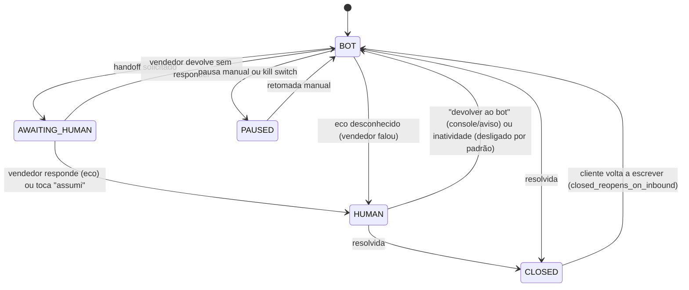
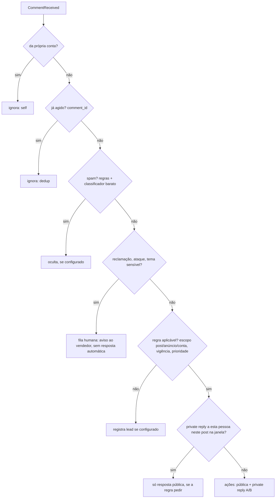

# 05 — Canais e inbox humano

Duas portas, nenhuma presa ao Instagram: `ChannelAdapter` (por onde a mensagem entra e sai) e `HumanInboxPort` (onde o humano atende e como é avisado). No MVP: `InstagramGraphAdapter` (Instagram API **with Facebook Login**) e um inbox humano formado pelo app do Instagram + `WhatsAppCloudNotifier` (com fallback por e-mail).

## 1. Portas

```python
class ChannelCapabilities(BaseModel):
    max_text_bytes: int                  # IG: 1000 (UTF-8)
    quick_replies: QuickReplyCaps | None # IG: max 13, title <= 20 chars, mobile only
    buttons: ButtonCaps | None           # IG generic template: <= 3 buttons (postback, web_url)
    media_out: dict[str, MediaLimit]     # IG: image png/jpeg 8 MB; audio/video/pdf 25 MB
    typing_indicator: bool               # IG: sender_action typing_on
    window: WindowPolicy                 # IG: 24h after last user message; no templates outside
    supports_templates: bool             # WhatsApp: True
    send_rate: RateProfile               # IG: text 100/s, audio/video 10/s per account

class ChannelAdapter(Protocol):
    channel: str
    def capabilities(self, account: ChannelAccount) -> ChannelCapabilities: ...
    def verify_and_parse(self, headers: Mapping[str, str], body: bytes) -> list[CanonicalEvent]: ...
    async def send(self, account: ChannelAccount, item: OutboxItem) -> SendResult: ...   # returns external_mid or raises Ambiguous/Retryable/Permanent
    async def window_state(self, conversation: ConversationView) -> WindowState: ...
    async def fetch_media(self, account: ChannelAccount, ref: MediaRef) -> bytes: ...

class HumanInboxPort(Protocol):
    async def notify_handoff(self, handoff: HandoffNotice) -> NotifyResult: ...
    async def assign(self, conversation_id: UUID, seller_id: UUID) -> None: ...
    async def add_note(self, conversation_id: UUID, note: str) -> None: ...       # no-op in MVP (IG app has no notes)
    async def return_to_bot(self, conversation_id: UUID, actor: UUID) -> None: ...

class Notifier(Protocol):                 # used by the MVP HumanInboxPort
    async def send_alert(self, seller: SellerContact, alert: Alert) -> NotifyResult: ...
    def parse_action(self, payload: bytes, headers: Mapping[str, str]) -> SellerAction | None: ...  # "took" | "return_to_bot"
```

Novos canais (WhatsApp, Messenger, webchat, Connect) entram como **novos adaptadores**; o agente, o outbox e o despachante não mudam.

## 2. Eventos canônicos

Todos com `tenant_id`, `channel`, `channel_account_id`, `external_ids` (mid, comment_id, media_id, ad_id), `contact_external_id` (IGSID), `provider_ts`, `payload_raw`.

| Evento | Origem no Instagram (Facebook Login) | Observação |
| --- | --- | --- |
| `MessageReceived` | `messages` com `message{mid, text, attachments}` | Áudio: `attachments[].type = "audio"`, `payload.url` (CDN com expiração não documentada → baixar na hora) |
| `StoryReply` | `message.reply_to.story{url, id}` | Origem `story_reply` |
| `StoryMention` | attachment `story_mention` | Origem `story_mention` |
| `Referral` | `referral{ref, ad_id, source: "ADS", type: "OPEN_THREAD", ads_context_data}` ou ig.me (`ref`) | Atribuição a anúncio/campanha |
| `Postback` | `postback{mid, title, payload}` (ice breaker, botão) e `message.quick_reply.payload` | |
| `CommentReceived` | `comments`: `id`, `from{id, username}`, `text`, `media{id, media_product_type}`, `parent_id` | `live_comments` também |
| `MessageEcho` | `message.is_echo = true` | Pode ser nosso envio ou o vendedor (seção 4) |
| `MessageEdited` / `MessageDeleted` | `message_edit` / `is_deleted` | Atualiza o histórico; não dispara turno |
| `Reaction` | `message_reactions` | Não gera eco; sem turno (salvo reação a pergunta de sim/não, configurável) |
| `DeliveryStatus` / `Read` | `messaging_seen` | Métrica |
| `ConversationStatusChanged` | `messaging_handover`/`standby` (Conversation Routing), futuro Connect | Sinal de humano adicional |

## 3. `InstagramGraphAdapter` (Instagram API with Facebook Login)

Fatos verificados em 09/10/2026 (fontes em [`18-fontes-externas.md`](18-fontes-externas.md)). Versão da Graph API fixada em config (`meta.graph_api_version`, inicial `v26.0`), revisada a cada release.

| Operação | Chamada |
| --- | --- |
| Enviar DM | `POST https://graph.facebook.com/{v}/{PAGE_ID}/messages`, `recipient.id = IGSID`, Page access token |
| Private reply | `POST /{PAGE_ID}/messages` com `recipient.comment_id` |
| Resposta pública | `POST /{ig-comment-id}/replies?message=…` (só comentário de 1º nível, não oculto, não live) |
| Ocultar comentário | `POST /{ig-comment-id}?hide=true` (usado para spam/ataque, se a regra mandar) |
| Typing | `POST /{PAGE_ID}/messages` com `sender_action = typing_on` |
| Ler conversa (reconciliação) | `GET /{PAGE_ID}/conversations?platform=instagram&user_id={IGSID}&fields=messages` (só as 20 mais recentes) |
| Ice breakers | `POST /me/messenger_profile?platform=instagram` |
| Validar token | `GET /debug_token` |

**Permissões necessárias** (Facebook Login): `instagram_basic`, `instagram_manage_messages`, `instagram_manage_comments`, `pages_manage_metadata`, `pages_show_list`, `pages_read_engagement`, `pages_messaging`, `business_management` (e `ads_read` se o papel na página vier via Business Manager). Inscrição da página: `POST /{PAGE_ID}/subscribed_apps` + campos do Instagram no App Dashboard (`messages`, `messaging_postbacks`, `messaging_referral`, `messaging_seen`, `message_reactions`, `message_edit`, `comments`, `live_comments`, `mentions`, `messaging_handover`, `standby`).

> **Risco de caminho crítico (R-01):** a doc oficial diz que **private replies exigem Advanced Access + o recurso Human Agent**, e que **webhooks de comentário exigem Advanced Access e app em modo Live**. Ou seja, mesmo atendendo uma conta só, o MVP de comentários depende de **verificação da empresa + App Review**. Standard Access cobre apenas usuários com papel no app (serve para desenvolver e testar com contas próprias). Fase 1 começa a verificação e o App Review no dia 1 (tarefa F1-META-02), e o DM (que não depende de comentário) é o primeiro fluxo a ir para produção. O uso do recurso Human Agent na revisão é **só para o vendedor**; a automação nunca usa a tag `HUMAN_AGENT`.

**Tokens:** o token de página derivado de um token de usuário de longa duração **não tem data de expiração**, mas é invalidado por troca de senha, logout, permissão revogada ou perda do papel na página (erro `190`, subcódigos `460`, `463`, `467`, `492`). Logo: job diário `token_guard` com `debug_token` (`is_valid`, `scopes`, `data_access_expires_at`), detecção de `190` em qualquer chamada → kill switch do canal + alerta + tela de reconexão (sequência no `07` §8.8). Isso **diverge do prompt**, que presumia o token de 60 dias do Instagram Login; o job continua existindo, com outra lógica.

**Limites** (por conta profissional): private replies 750/h (posts e reels) e 100/s em live; Conversations API 2/s; Send API 100/s para texto e 10/s para áudio e vídeo; erro `80002` ao estourar e header `X-Business-Use-Case-Usage` para ler o uso. Os buckets do Redis espelham esses números com margem de 20%.

**Formato:** texto ≤ 1.000 bytes UTF-8 (a doc também diz "< 1000 caracteres"; vale o mais restritivo, os bytes). O quebrador de bolhas corta por frase, sem partir grafema, e mede em bytes.

**Webhooks:** assinatura `X-Hub-Signature-256: sha256=…`; responder 200 em até 5 s; sem garantia de ordem (usar `timestamp`); retentativas por até 36 h; a Messenger Platform **desinscreve o app depois de 1 h de falhas**. Por isso o `api` fica separado dos workers, tem healthcheck e alerta de "nenhum webhook em X min no horário comercial".

## 4. Detecção de humano por eco (ADR-002)

```python
async def on_echo(evt: MessageEcho) -> None:
    if await outbox.has_mid(evt.mid):                 # our own send, already confirmed
        return mark_echo_known(evt)
    # race: echo before the API returned the mid, or a late echo of an ambiguous (unknown) send (review #7)
    if await outbox.has_match(evt.conversation, content_hash(evt), statuses=("sending", "unknown"),
                              within=cfg.concurrency.echo_reconcile_window_s):
        return await outbox.confirm_by_echo(evt)               # marks sent with the echo mid
    if not evt.rechecked:
        return schedule_recheck(evt, after=cfg.concurrency.echo_grace_s)
    if known_sender(evt):                             # configured native automations / other connected apps
        return mark_echo_known(evt)
    await ownership.transition(evt.conversation, to="HUMAN", cause="echo_unknown_mid", evidence=evt)
```

- O despachante registra `attempt_registered_at` + `content_hash` **antes** de enviar. Eco que casa com item `sending` ou `unknown` (mesmo `content_hash`, janela de `concurrency.echo_reconcile_window_s` = 120 s) confirma o nosso envio; eco que não casa espera `concurrency.echo_grace_s` (3 s) e é conferido de novo.
- Se o eco do Instagram trouxer `app_id` (a doc mostra isso no Messenger, mas não no Instagram), ele vira um sinal extra: `app_id == nosso app` → nosso; `app_id` do Instagram Inbox (`1217981644879628`) ou ausente → humano. **Validar na fase 1** (F1-META-04).
- Automações nativas do Instagram ou outros apps conectados à conta geram eco: desligar ou cadastrar como remetentes conhecidos.
- GIF e sticker podem não gerar webhook (a doc é inconsistente): o botão "assumi" no aviso cobre a lacuna.
- Testes da fase 1 no app real: (1) vendedor responde pelo app → eco chega? com que campos?; (2) nosso envio → eco antes ou depois da resposta HTTP?; (3) self messaging (`is_self`) para testes com uma conta só; (4) uma segunda conta de teste como cliente.

**Conversation Routing (opcional, ADR-001):** viável porque a conta usa Facebook Login com página. Ele daria eventos explícitos de troca de dono (`messaging_handover` com `new_owner_app_id`) quando o vendedor usa a Meta Business Suite Inbox. A doc não diz como as respostas pelo app nativo do Instagram interagem com o roteamento, então **o eco continua sendo o sinal obrigatório**; o Routing entra como sinal adicional na fase 5, se o teste da fase 1 mostrar ganho.

## 5. Posse da conversa



- Com posse `HUMAN`, `AWAITING_HUMAN` ou `PAUSED`, o bot não envia nada. Exceção configurável: **uma** mensagem de expectativa ao entrar em `AWAITING_HUMAN`.
- Toda transição incrementa `run_epoch` **e** `send_epoch` (cancela o run não comitado e o outbox pendente) e grava `ownership_events`, sob o advisory lock da conversa.
- **Opt-out vale em qualquer posse** (`privacy_gate` no `04` §1): grava a revogação e a supressão mesmo com o vendedor na conversa, sem o bot enviar nada.
- Ao detectar humano: cancela o run, cancela o outbox pendente da conversa e para os follow-ups.
- Com o vendedor na conversa, o turno roda em modo `silent_update`: atualiza perfil, estágio e resumo, sem saída.
- Retorno por inatividade: `handoff.return_to_bot_after_inactivity_min = null` (premissa P5).
- **Nenhuma conversa fica presa (revisão #9):**
  - Inbound do cliente com posse `HUMAN` ou `AWAITING_HUMAN` sem resposta do vendedor em `handoff.human_unanswered_realert_min` (30 min, no horário humano) gera um novo aviso.
  - Inbound em `CLOSED` reabre a conversa como `BOT`.
  - A métrica `inbound_without_reply` (conversas com mensagem do cliente sem nenhuma resposta, de bot ou humano, há mais de 1 h) entra no dashboard e nos alertas.
- **Handoff fora do horário humano (revisão #8):**
  - Com `handoff.off_hours_mode = bot_keeps_serving` (padrão), a posse **continua `BOT`** com `handoff_pending = true`.
  - O bot segue atendendo e qualificando, com a diretriz "não insistir na venda; o vendedor responde a partir das 8h".
  - Às 8h (abertura do horário humano), a conversa passa para `AWAITING_HUMAN`, e o aviso ao vendedor sai (`notify_off_hours = at_open`, para não acordar o vendedor de madrugada).
  - Se o caso exige humano já (reclamação grave, dado sensível), o bot só responde à expectativa e não trata do assunto.

## 6. Handoff e aviso ao vendedor

**Gatilhos** (núcleo + pacote): pedido explícito de humano, frustração ou reclamação, baixa confiança repetida, turnos sem progresso, falha técnica, lead quente, e os do pacote (`13` §2.7).

**`WhatsAppCloudNotifier`** (ADR-010):

- Número da plataforma na WhatsApp Cloud API (não o número pessoal do vendedor), com display name aprovado e portfólio verificado (sem verificação, o limite é de 250 templates e 2 números, o que basta).
- Opt-in do vendedor registrado (`consents.purpose = seller_alerts`).
- Template **utility** `handoff_alert_v1` (pt_BR) com variáveis mínimas e dois botões de resposta rápida:

```text
Novo atendimento para você ({{1}}): {{2}} quer falar com você.
Estágio: {{3}} · Motivo: {{4}}
Resumo: {{5}}
Abrir no console: {{6}}
[Assumi]  [Devolver ao bot]
```

  `{{2}}` = primeiro nome; `{{5}}` = resumo **sem dados sensíveis** (≤ 300 caracteres); `{{6}}` = link para o console (expira em 24 h) que **exige login** do vendedor (o link sozinho não abre a conversa; revisão #21).
- O toque no botão chega como webhook `type: "button"` com `payload` (`took:<handoff_id>:<sig>` ou `return:<handoff_id>:<sig>`), assinado com HMAC para não ser forjado; vira `SellerAction`.
- Custo: desde 01/10/2026, mensagens de serviço e utility dentro da janela também são cobradas, na tarifa de utility. Ordem de grandeza: centavos de real por aviso (o valor exato vem do rate card oficial do Brasil, a confirmar). Com 10 handoffs/dia, menos de R$ 1/dia.
- **Fallback:** se o template não estiver aprovado, o número cair ou o envio falhar, o aviso vai por e-mail (SMTP transacional), com os mesmos dados e links assinados para os botões.
- **SLA:** `handoff.sla_minutes` (padrão 30 no horário humano). Estourou → segundo aviso; com vários vendedores, re-roteia pela regra (round-robin, por cidade, por segmento).

**Mensagem ao cliente:** transparente e com expectativa real. No horário humano: "Vou chamar o {{seller}} para continuar com você por aqui." Fora do horário (22h–8h): "O {{seller}} responde a partir das 8h. Enquanto isso, posso tirar outras dúvidas." Sem insistir na venda.

## 7. Automação de comentários



- Gatilhos em ordem de custo: palavra-chave → regex → intenção por LLM (só se a regra pedir e houver orçamento; modelo mais barato).
- Resposta pública: sorteio entre variantes aprovadas (nunca a mesma frase em sequência para o mesmo post), sem PII, preço ou simulação, e convida para o direct.
- Private reply: variante A/B com peso; texto curto que termina numa pergunta simples ("Quer que eu te explique como funciona para imóvel ou para carro?"). Métrica: taxa de resposta por variante (`10`).
- Janela de dedup por pessoa e post: `comments.private_reply_dedup_window_days = 7`, garantida por **claim atômico** em `private_reply_claims` (`insert ... on conflict ... where claimed_at < now() - window returning`). Não é check-then-act, então dois comentários paralelos da mesma pessoa geram uma única private reply (revisão #11).
- Prioridade sob backlog (post viral): recência e intenção; alerta em 80% do limite/h. Private reply adiada mais de 1 h respeita o horário silencioso (checagem 6 do despachante).

## 8. Identidade do contato

- `contact_identities` liga IGSID (e, depois, `wa_id`, e-mail do webchat) ao `contact`.
- Merge automático **só** com identificador forte confirmado (telefone verificado por código ou e-mail confirmado). Nome igual, foto ou @ parecido → `contact_merge_suggestions` para um humano aprovar.
- IGSID é escopado à página/app: trocar de app gera IDs novos (migrações de app exigem um mapa).

## 9. Tabela de restrições verificadas (09/10/2026)

| Tema | Regra verificada | Implicação | Diverge do prompt? |
| --- | --- | --- | --- |
| Host e token | Facebook Login → `graph.facebook.com`, Page token | Adaptador usa Page ID | — (decisão do usuário) |
| Validade do token | Page token derivado de user token longo não expira; invalidado por eventos (190) | `token_guard` diário + reação a 190 | **Sim** (prompt: 60 dias) |
| Acesso | Standard Access = usuários com papel no app; private reply e webhook de comentário exigem Advanced Access + Human Agent; Advanced exige empresa verificada | App Review no caminho crítico (R-01) | **Sim** (prompt: Standard bastaria para o 1º cliente) |
| Private reply | 1 por comentário, até 7 dias; live só durante a transmissão; vai para Requests se não segue | Igual ao prompt | Não |
| Limites | 750 private replies/h; 100/s live; Conversations 2/s; Send 100/s texto, 10/s áudio e vídeo | Buckets por tipo | Acrescenta 10/s de mídia |
| Janela | 24 h; `HUMAN_AGENT` 7 dias só para humano, com App Review | Automação nunca usa a tag | Não |
| Formato | 1.000 bytes; imagem 8 MB; áudio, vídeo e PDF 25 MB; quick replies ≤ 13 | Quebra em bytes | Não |
| Eco | `is_echo` sem `app_id` nos exemplos do Instagram (o Messenger tem) | Comparação por `mid` + teste real | Parcial |
| GIF/sticker | Doc inconsistente | Botão "assumi" | Parcial |
| Handover | Substituído por Conversation Routing (23/10/2025) | Opcional | Não |
| Idempotência | Nenhuma chave documentada | Reconciliação por eco | Não |
| Webhooks | 200 em até 5 s; retentativas por até 36 h; desinscrição após 1 h de falha (Messenger Platform) | Fast-ack + alerta | Acrescenta desinscrição |
| WhatsApp serviço | Cobrança de serviço e utility dentro da janela desde 01/10/2026 (oficial); franquia de 1.000/mês **não** confirmada na doc oficial | Custo por mensagem é parâmetro | Parcial |
