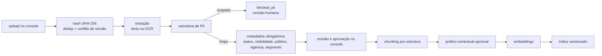

# 06 — Base de conhecimento: dados estruturados, FAQs e RAG

Três camadas, nesta ordem de confiança: **dados estruturados** lidos por ferramenta → **FAQs curadas** com resposta canônica → **RAG** sobre documentos aprovados. O modelo nunca responde de memória sobre produto; abaixo do limiar, o turno sai marcado `no_basis` e a pergunta vai para a curadoria.

## 1. Knowledge Service

```python
class KnowledgeService(Protocol):
    async def match_faq(self, tenant: UUID, question: str, segment: str) -> FaqHit | None: ...
    async def search(self, tenant: UUID, query: KnowledgeQuery) -> RetrievalResult: ...
    async def report_gap(self, tenant: UUID, question_masked: str, turn_id: UUID) -> None: ...

class VectorStore(Protocol):            # pgvector by default (ADR-006); Qdrant adapter possible
    async def upsert(self, index_id: UUID, chunks: list[ChunkRecord]) -> None: ...
    async def hybrid_search(self, index_id: UUID, q_text: str, q_vec: list[float],
                            filters: ChunkFilter, k: int) -> list[ScoredChunk]: ...
```

Fluxo do `retrieve`:

1. Para cada pergunta do `TurnUnderstanding.questions` (no máximo 2 por turno):
2. `match_faq`: embedding da pergunta × `faq_variants`; se `score ≥ rag.faq_threshold` (padrão 0,86, calibrado), devolve a resposta canônica. O `respond` só pode ajustar o tom, e o guard compara os fatos (números e negações) com a resposta canônica.
3. Senão, `hybrid_search`: FTS `pt_unaccent` (top 30) + vetor (top 30), fundidos por RRF (`k=60`), filtrados por `tenant/pacote`, `status='approved'`, vigência e `visibility`; rerank opcional (ADR-006); devolve `top_k` (padrão 4).
4. Se o melhor score depois do rerank ficar abaixo de `rag.min_score`, ou se nenhum trecho cobrir os termos-chave da pergunta, marca `no_basis = true` e chama `report_gap`.

SQL de referência da busca híbrida:

```sql
with q as (select websearch_to_tsquery('pt_unaccent', :q_text) as tsq, (:q_vec)::vector(1024) as v),
fts as (
  select c.id, row_number() over (order by ts_rank_cd(c.tsv, q.tsq) desc) as r
  from kb_chunks c, q
  where c.index_id = :idx and c.tsv @@ q.tsq and <filters>
  limit 30),
vec as (
  select c.id, row_number() over (order by (c.embedding::vector(1024)) <=> q.v) as r
  from kb_chunks c, q
  where c.index_id = :idx and <filters>
  order by (c.embedding::vector(1024)) <=> q.v limit 30)
select id, sum(1.0 / (60 + r)) as rrf
from (select * from fts union all select * from vec) u
group by id order by rrf desc limit :k_pre_rerank;
```

## 2. Camada 1 — dados estruturados

- Tabelas genéricas `domain_datasets` + `domain_rows` (`03`), com o schema de cada dataset declarado pelo pacote. No consórcio: `plans`, `bid_rules`, `group_results`, `units`, `required_documents`.
- Importação validada: upload (CSV/XLSX) → parse → validação de schema → **prévia** no console com diff da versão ativa → aprovação → ativação. Rollback = reativar a versão anterior.
- Toda resposta de ferramenta carrega `dataset_id` e `version`; o guard usa isso como proveniência.

## 3. Camada 2 — FAQs

Campos: pergunta canônica, variações, resposta aprovada, segmento, vigência, responsável, aprovador. Nascem de três fontes: (a) escritas à mão com o cliente; (b) extraídas dos documentos por LLM no laboratório, **sempre com revisão humana**; (c) promovidas da fila de curadoria.

## 4. Camada 3 — RAG sobre documentos aprovados

**Pipeline de ingestão** (worker `ingest`, fila de baixa prioridade):



- **Extração:** texto nativo por `pdfplumber`/`pypdf`; estrutura (títulos, tabelas) com Docling quando o laboratório mostrar ganho (ADR-015). PDF sem camada de texto → OCR (`ocrmypdf` + Tesseract `por`) e revisão humana obrigatória.
- **PII:** regex com dígito verificador (CPF, CNPJ, cartão, telefone, e-mail), padrões de URL com chave/token, nomes próprios por NER leve e um dicionário de termos de saúde (CID, "doença", "cirurgia" etc. em contexto de pessoa). Qualquer achado → `blocked_pii` até revisão.
- **Metadados obrigatórios:** `status` (`approved`, `superseded`, `do_not_use`), `visibility` (`citable` = pode ser citado ao cliente; `guidance_only` = só orienta), `audience`, `segment`, `effective_from/to`, `approved_by`. Sem eles o documento não é indexado (anti-padrão da §17).
- **Chunking:** padrão "recursivo por títulos" com alvo de 350 tokens e sobreposição de 15%, mas a escolha final sai da matriz do laboratório (`10` §lab-RAG), medida por token (IoU, precisão e recall).
- **Reindexação incremental por hash**; documento vencido ou `superseded` sai do índice ativo.
- **Trecho no prompt:** delimitado como dado, com `chunk_id` e `visibility`. Trecho `guidance_only` orienta a resposta, mas o guard bloqueia citação literal longa (n-grama ≥ 12 tokens) e menção ao documento.

**Precedência das bases:** dado estruturado do tenant > dado estruturado do pacote > FAQ do tenant > FAQ do pacote > RAG do tenant > RAG do pacote. Em conflito entre fontes do mesmo nível, vale a mais nova voltada ao cliente, e o conflito gera alerta de curadoria.

## 5. Governança e curadoria

- Só `approved` chega à produção. Aprovador configurável (no primeiro tenant, o próprio vendedor), com trilha no `audit_log`.
- Fila de curadoria no console: perguntas `no_basis` mascaradas, agrupadas por similaridade (embedding + HDBSCAN offline diário) e ordenadas por frequência. Ações: virar FAQ, anexar documento, marcar fora de escopo.
- Alertas de conflito: o mesmo fato com valores diferentes em documentos aprovados (detectado por extração de "fatos-chave" do pacote, como um limite ou uma taxa).

## 6. Avaliação da recuperação

Dataset `rag-ptbr-v1`: 60 perguntas reais ou plausíveis por pacote, cada uma com a resposta esperada e os trechos relevantes marcados (ids + spans), escritas a partir do material aprovado e revisadas. Métricas: recall@k, MRR, nDCG, taxa de `no_basis` correta (pergunta sem resposta na base precisa dar `no_basis`), fidelidade e correção (só nas finalistas). Detalhe no `10`.

## 7. Material

O inventário do material de cada cliente fica com o material, fora deste repositório (ADR-023).
