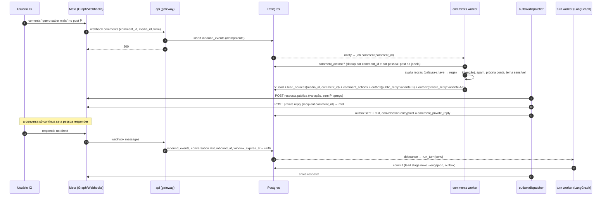
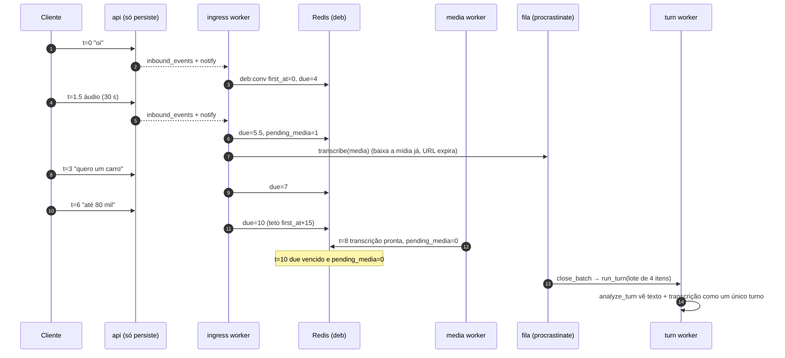
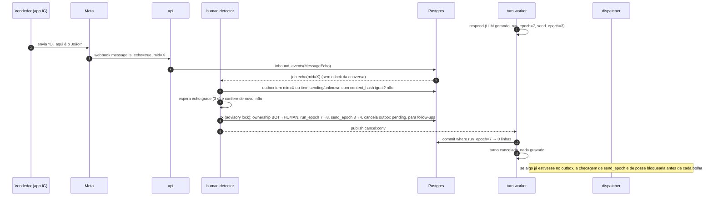
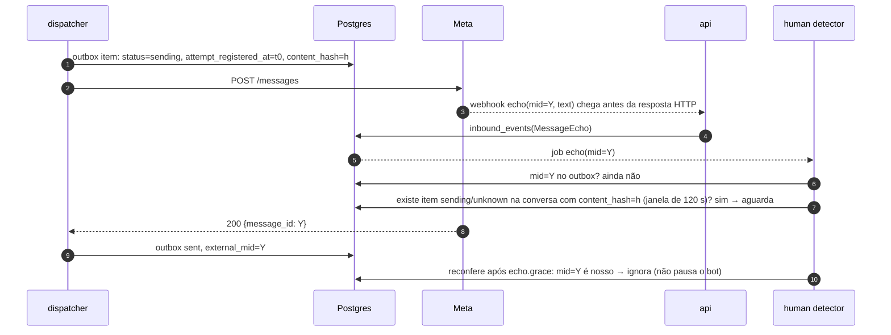
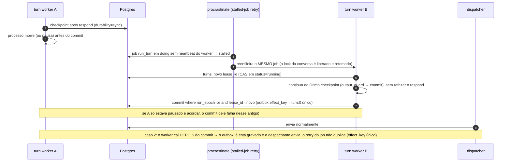
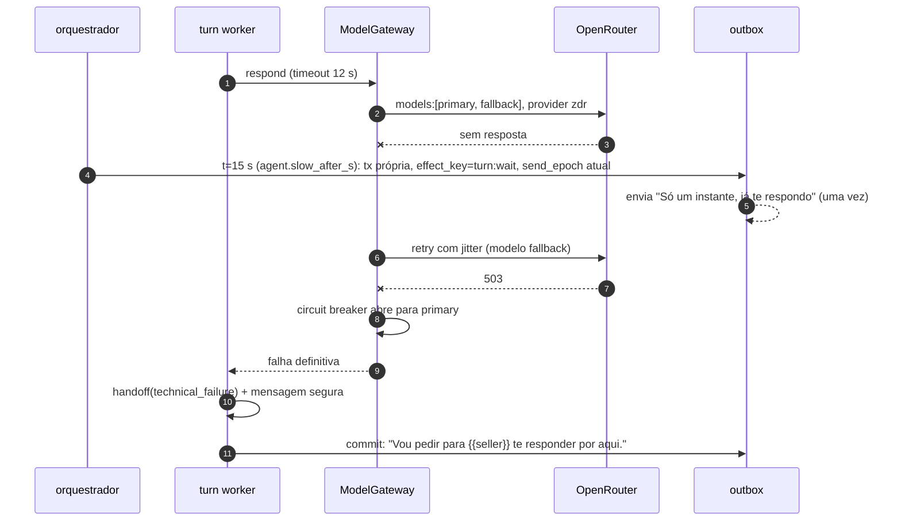
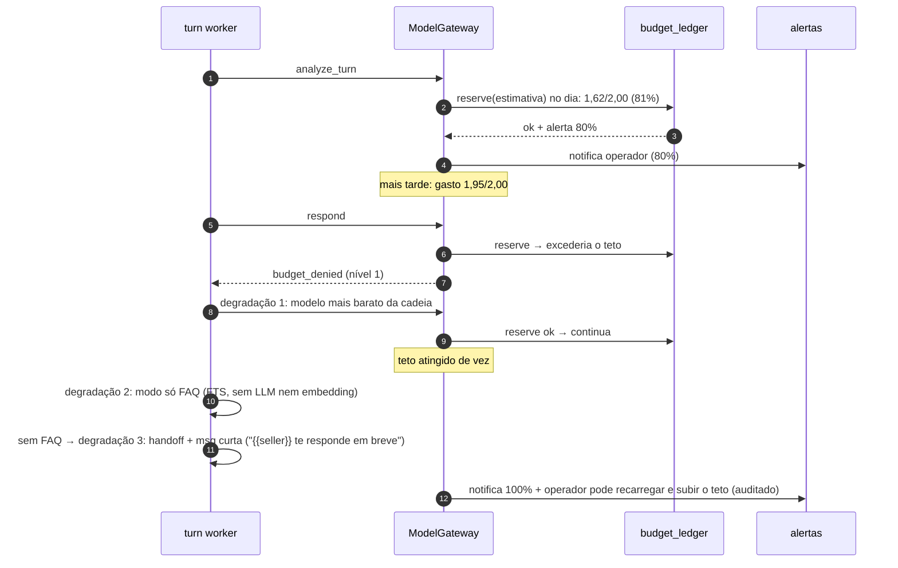
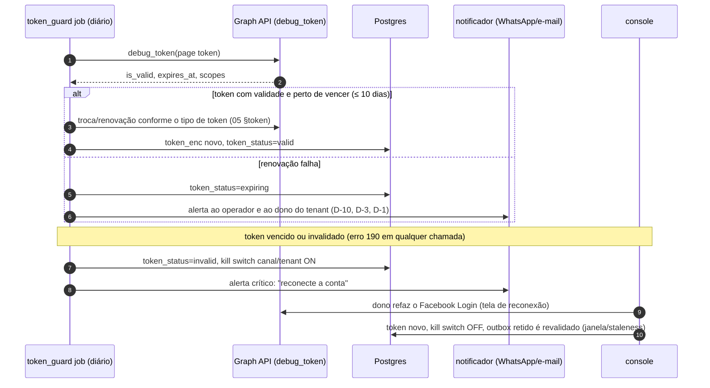
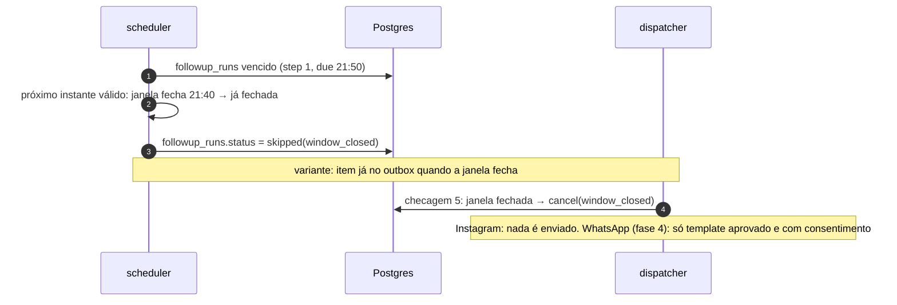
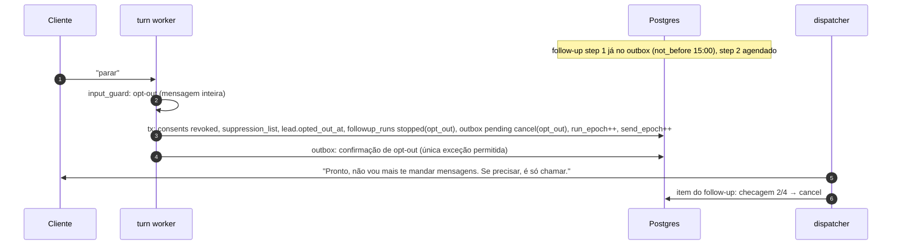

# 07 — Confiabilidade e concorrência

Invariantes: **cada evento produz efeito no máximo uma vez; cada conversa tem no máximo um run ativo; cada envio é decidido de novo no último instante antes de sair.**

## 1. Entrada

- **Fast-ack:** `POST /webhooks/meta` valida `X-Hub-Signature-256` (HMAC-SHA256 com o app secret, comparação em tempo constante), normaliza, grava em `inbound_events` (`unique(channel_account_id, idempotency_key)`, `on conflict do nothing`) e responde 200. Meta: p99 ≤ 300 ms. Nada de LLM, Graph API ou Redis no caminho síncrono (se o Redis cair, o webhook continua funcionando).
- **Postgres indisponível (revisão #17):** a Messenger Platform desinscreve o app depois de 1 h de falhas, então "503 e a Meta reentrega" não basta. O `api` grava o corpo assinado num **spool local durável** (arquivo append-only com `fsync` num volume) e responde 200; um replayer reinsere em `inbound_events` (idempotente) quando o Postgres volta. Spool acima de N MB ou de 2 h de idade → alerta crítico.
- **Despacho:** um trigger `after insert` faz `pg_notify('inbound', id)`; o worker `ingress` consome, **atualiza o Redis (debounce)** e enfileira o job certo (procrastinate). O `api` nunca toca no Redis. Um sweeper a cada 30 s pega `pending` antigos (caso o notify se perca).
- **Ingestão já para cadências:** inbound de cliente para os follow-ups pendentes da conversa no próprio `ingress` (antes do turno), não só no `commit` (revisão #10).
- **Ordem:** dentro da conversa, por `provider_ts`; empate pelo `received_at`. Eventos fora de ordem que chegam depois de um turno já fechado viram parte do próximo lote.

## 2. Debounce de rajadas

- `deb:{conv}` no Redis: cada mensagem nova empurra `due = min(now + debounce.window, first_at + debounce.max_wait)`. Padrões para o Instagram: `window = 4 s`, `max_wait = 15 s`.
- Áudio ou imagem em processamento (`pending_media > 0`) segura o lote até a transcrição terminar (teto `media.max_wait = 25 s`; se estourar, segue com "[áudio não transcrito]" e o agente pede para repetir por texto).
- O job `close_batch` (procrastinate, `schedule_at = due`) fecha o lote e enfileira `run_turn(conv)` com `lock = conversation_id` e `queueing_lock = conversation_id` (no máximo um turno pendente por conversa; se já houver, o novo lote é anexado a ele).
- **Se o Redis cair:** o `close_batch` usa um fallback em Postgres (`inbound_events` `pending` da conversa com mais de `max_wait`), e o debounce degrada para "janela fixa" sem perder mensagem.

## 3. Uma execução por conversa

Decisão (ADR-004 e ADR-005):

1. **Serialização pela fila:** `run_turn` é deferido com `lock=conversation_id` no procrastinate; conversas diferentes rodam em paralelo, e a mesma conversa roda em série. Só `run_turn` usa esse lock: os jobs de eco, mídia, despacho e follow-up **não** usam o lock da conversa (senão um turno longo atrasaria a detecção do vendedor).
2. **Dois epochs com papéis diferentes (revisão #5):**
   - `run_epoch` protege o **commit**. É incrementado quando um run **ainda não comitado** é cancelado (lote novo, mudança de posse). O `commit` faz `update conversations ... where id = :c and run_epoch = :epoch` e `update turns ... where status='running' and lease_id = :lease` dentro de `pg_advisory_xact_lock(hashtext(conv))`; se qualquer um afetar 0 linhas, o turno é descartado.
   - `send_epoch` protege o **envio**. É incrementado **só** por mudança de posse, kill switch e opt-out. O despachante envia apenas itens cujo `send_epoch` é igual ao da conversa. Assim, um lote novo depois do commit **não** corta as bolhas 2..n da resposta anterior.
   - O incremento de `run_epoch` pelo `close_batch` acontece sob o mesmo `pg_advisory_xact_lock` e só se o turno corrente estiver `running` (não comitado): a decisão "nada enviado ainda" é atômica com o commit.
3. **Por que não Redis lock:** um lock no Redis sem fencing verificado no recurso não impede duas escritas quando há pausa de GC ou partição (Kleppmann). O recurso protegido é o Postgres, então o fencing fica nele.

**Intercalações obrigatórias nos testes (F1-OWN-01 e F1-OUT-01):** (a) lote novo antes do commit; (b) lote novo entre o commit e a 1ª bolha; (c) lote novo entre as bolhas 1 e 2; (d) eco do vendedor antes do commit; (e) eco do vendedor entre bolhas; (f) opt-out entre bolhas; (g) kill switch entre bolhas; (h) worker pausado (SIGSTOP 60 s) e retomado depois do retry do job; (i) timeout ambíguo do envio seguido de eco atrasado (10 s, 90 s); (j) dois comentários da mesma pessoa no mesmo post processados em paralelo.

### Mensagem nova durante um run (ADR-012)

- Se o turno **ainda não comitou** (estado `running`): o `close_batch` do novo lote incrementa o `run_epoch` (sob o advisory lock) e publica `cancel:{conv}`. O worker cancela a task asyncio do run (mecanismo principal) ou o run chega ao `commit` e falha no fencing. `RunControl.request_drain` do LangGraph 1.2 só entra se o spike F1-LG-01 confirmar a API. A mensagem de espera (§6) **não** conta como "já enviado". Um novo `run_turn` roda com o lote combinado (mensagens antigas + novas). Custo: as chamadas de LLM já feitas são perdidas (registradas em `llm_calls` com `status = cancelled`).
- Se o turno **já fez commit** (há itens no outbox): o novo lote vira o próximo turno, e os itens ainda `pending` do turno anterior seguem, porque já respondem a algo que o cliente disse. Exceção configurável: se o novo lote contém opt-out ou pedido de humano, o outbox pendente da conversa é cancelado.
- Teto anti-starvation: no máximo 2 reinícios seguidos por conversa; depois disso, o turno roda até o fim e o resto vira o próximo turno.

## 4. Durabilidade e idempotência

- **Checkpointer** `AsyncPostgresSaver` (`langgraph-checkpoint-postgres` 3.1.x), com `durability="sync"` na execução do turno (o parâmetro vale por execução; evita refazer uma chamada LLM já cobrada depois de uma queda), `EncryptedSerializer` e `LANGGRAPH_STRICT_MSGPACK=true`.
- **IDs determinísticos de efeito:** `outbox.effect_key = turn_id:bubble_idx`; `tool_calls.idempotency_key = turn_id:tool:seq`; `comment_actions` único por `comment_id`; `followup_runs` único por `(conv, cadence, step)`.
- **Transactional outbox:** o `commit` grava estado de negócio + itens de outbox + `turns.status=committed` numa transação. Cada bolha é um item.
- **Sem chave de idempotência na Graph API** (confirmado por ausência na doc): o despachante marca `attempt_registered_at` e `status=sending` **antes** de chamar a API. Em timeout ou erro ambíguo, o item vai para `unknown`. **Duplicata pesa mais que perda (prioridade 2 > 3), então nunca há reenvio às cegas (revisão #7):**
  1. Eco com o mesmo `content_hash` no mesmo thread, a qualquer momento dentro de `concurrency.echo_reconcile_window_s` (120 s) → `sent` com o `mid` do eco. O detector de humano casa ecos com itens `sending` **e** `unknown` nessa janela, então um eco atrasado do nosso envio nunca vira "humano".
  2. Sem eco até o fim da janela → consulta `GET /{PAGE_ID}/conversations?user_id=…&fields=messages` e procura a mensagem pelo texto. Achou → `sent`.
  3. Não achou → `failed` + handoff ("Vou pedir para {{seller}} confirmar com você"), **sem reenviar**.
- **Recuperação de run travado (revisão #6):** só pelo próprio procrastinate. O worker mantém heartbeat; um job `doing` com worker sem heartbeat é tratado como *stalled* e reenfileirado pelo mecanismo de retry de jobs travados da biblioteca (spike F1-Q-02 confirma a API na versão 3.10), liberando o `lock` da conversa. O novo executor retoma do checkpoint com um **lease novo** (`turns.lease_id`); o executor antigo, se estiver só lento, perde o CAS do commit (`lease_id` diferente) e o fencing do `run_epoch`. Não existe executor paralelo fora do job. Depois de 2 retomadas sem sucesso → handoff com mensagem de falha técnica. Teste: SIGSTOP de 60 s no worker no meio do `respond`.
- **Itens velhos:** o despachante revalida itens com idade > `max_staleness` (padrão 120 s para resposta, 10 min para follow-up): se a conversa recebeu mensagem nova depois do turno de origem, cancela (`stale`).

## 5. Despachante: a checagem da última milha

Para cada item, em ordem de prioridade (`0` conversa ativa, `1` comentário, `2` follow-up, `3` campanha):

```text
1. kill switch (global/canal/tenant/feature) ligado?        → cancel(kill_switch)
2. send_epoch do item == send_epoch atual da conversa?      → senão cancel(superseded)
3. ownership == BOT? (exceto a msg de expectativa do handoff) → senão cancel(ownership)
4. contato fez opt-out (ou está na supressão)?               → cancel(opt_out)  [exceto a confirmação do opt-out]
5. janela do canal aberta para este tipo de envio?           → senão cancel(window_closed)
6. is_proactive (ou resposta adiada > 1 h) e horário silencioso/feriado? → reschedule(next_allowed) ou cancel
7. is_proactive e existe inbound com provider_ts > item.created_at?      → cancel(customer_spoke)
8. idade > max_staleness e chegou msg nova depois do turno de origem?    → cancel(stale)
9. sha256(payload.text) == content_hash?                     → senão cancel(tampered) + alerta
10. rate limit (token bucket da conta) permite?              → senão reschedule(+backoff)
11. registra attempt (status=sending) → chama ChannelAdapter.send → grava sent/mid ou unknown
```

Resposta a mensagem ou a comentário do cliente sai a qualquer hora (checagem 6 só para `is_proactive` e para private reply adiada mais de 1 h, como no backlog de post viral). Entre bolhas: `typing_on` quando o canal suportar e intervalo de `conversation.bubble_delay_ms` (padrão 1.200 ms); as checagens 1–5 rodam de novo antes de **cada** bolha.

## 6. Falhas de LLM e dependências

| Falha | Comportamento |
| --- | --- |
| Timeout por chamada | Retry com backoff exponencial e jitter, só para erro transitório (timeout, 429, 5xx); máximo 2 |
| Modelo indisponível | `models: [primary, fallback]` no OpenRouter + circuit breaker por modelo no Redis (abre com 5 falhas em 60 s) |
| Turno lento | Depois de `agent.slow_after_s` (padrão 15 s), o **orquestrador** (não o `ModelGateway`) grava no máximo **uma** mensagem de espera no outbox, numa transação própria, com `effect_key = turn_id:wait` e o `send_epoch` atual (revisão #12); o turno continua. A espera não conta como "já enviado" para o ADR-012 |
| Falha definitiva | Handoff com contexto + mensagem segura ("Vou pedir para {{seller}} te responder") |
| Orçamento esgotado | Degradação em ordem (`08` §orçamento) |
| Graph API 5xx/timeout | Retry com backoff; reconciliação pelo eco |
| Graph API 190 (token inválido) | Kill switch automático do canal do tenant + alerta + tela de reconexão |
| Redis fora | Webhook segue; debounce cai para janela fixa no Postgres; rate limit cai para um limitador local conservador; circuit breaker fechado |
| Postgres fora | Webhook grava no spool local e responde 200 (§1); workers param; nada é enviado; replay quando voltar |
| App desinscrito dos webhooks | Job a cada 10 min confere `GET /{page}/subscribed_apps` e reinscreve; backfill de mensagens (`/conversations`, 20 últimas por conversa) e de comentários (`GET /{media-id}/comments` dos posts ativos nos últimos 7 dias) |

**DLQ:** procrastinate marca jobs `failed` depois de `max_attempts`; `dead_letters` recebe o resumo; alerta; reprocessamento pelo console (botão "reprocessar" que re-enfileira com nova tentativa).

## 7. Capacidade e prioridade

- Filas procrastinate por prioridade: `turns` (conversa ativa), `comments`, `followups`, `campaigns`, `ingest`, `lab`. Workers dedicados ou com pesos: um worker pode atender `turns,comments`, e outro `followups,campaigns,ingest,lab`. Campanha nunca ocupa um slot de `turns`.
- Rate limiters: por conta de canal (private replies/h, envios/s, Conversations API/s) e por modelo. Backpressure: se o bucket de private replies estiver abaixo de 20%, as regras de comentário priorizam por recência e intenção (comentário com intenção de compra primeiro) e alertam.
- **Cenário de post viral (teste de carga):** 5.000 comentários em 1 h → o sistema registra todos os leads, responde publicamente com variação (limite próprio), manda até o teto de private replies por hora ordenadas por prioridade e deixa o resto `deferred` dentro dos 7 dias; nenhuma conversa ativa passa de p95 de 20 s.
- **Kill switches:** global, por canal, por tenant, por campanha e por funcionalidade (`comments.auto_reply`, `followups`, `agent.respond`). Cache de 5 s → efeito em segundos.

## 8. Diagramas de sequência obrigatórios

### 8.1 Comentário → resposta pública + private reply → pessoa responde no direct → conversa



### 8.2 Rajada de quatro mensagens em seis segundos, incluindo um áudio



### 8.3 Vendedor responde pelo app do Instagram enquanto o LLM ainda gera a resposta



### 8.4 Eco do nosso próprio envio chega antes de a API devolver o `mid`



### 8.5 Worker cai entre gerar a resposta e enviá-la



### 8.6 OpenRouter lento ou fora do ar no meio de um turno



### 8.7 Orçamento de LLM acaba no meio do dia



### 8.8 Token do Instagram perto de vencer, e vencido



### 8.9 Follow-up agendado quando a janela de 24 h já fechou



### 8.10 Opt-out no meio de uma cadência



## 9. Testes de caos e concorrência (no pipeline do `10`)

| Teste | Como | Esperado |
| --- | --- | --- |
| Matar worker no meio do turno | `docker kill` durante o `respond` (fixture com LLM lento) | Retomada do checkpoint, 1 resposta, 0 duplicada |
| Matar worker depois do commit | Kill entre o commit e o envio | 1 envio |
| Derrubar o Redis | `docker stop redis` com tráfego | 0 perda; latência maior; nenhum envio duplicado |
| OpenRouter 500 e timeout | Proxy de falhas (toxiproxy) | Fallback, mensagem de espera única, handoff no fim |
| Webhook duplicado | Reenviar o mesmo payload 3× | 1 `inbound_event`, 1 efeito |
| Webhook fora de ordem | Embaralhar timestamps | Turno com ordem por `provider_ts` |
| Eco antes do `mid` | Adaptador falso que entrega o eco antes da resposta HTTP | Bot não pausa |
| Vendedor fala durante a geração | Eco desconhecido injetado no meio do `respond` | Nada enviado pelo bot; posse HUMAN |
| Post viral | 5.000 comentários/h no adaptador falso | Teto de private replies respeitado; p95 de conversas ≤ 20 s |
| Kill switch | Ligar no meio do envio de bolhas | Bolhas restantes canceladas em ≤ 5 s |
| Worker pausado | SIGSTOP 60 s durante o `respond`, depois SIGCONT | Job stalled reenfileirado; 1 commit (lease novo); o antigo falha no CAS |
| Envio ambíguo + eco atrasado | Timeout no envio; eco em 10 s e em 90 s | `sent` pelo eco; bot **não** pausa; nenhum reenvio |
| Envio ambíguo sem eco | Timeout e eco nunca chega | Consulta `/conversations`; sem achar → `failed` + handoff; 0 duplicata |
| Opt-out com posse humana | "parar" com posse `HUMAN` | Supressão gravada; nada enviado pelo bot |
| Lote novo entre bolhas | Mensagem do cliente entre a bolha 1 e a 2 | Bolha 2 sai (send_epoch inalterado); o lote vira o próximo turno |
| Follow-up × cliente | Cliente escreve 1 s antes do follow-up sair | Follow-up cancelado (`customer_spoke`) |
| Comentários paralelos | 2 comentários da mesma pessoa no mesmo post ao mesmo tempo | 1 private reply (claim atômico) |
| Postgres fora > 1 h | Parar o Postgres com webhooks chegando | 200 com spool; replay sem perda; app segue inscrito |
