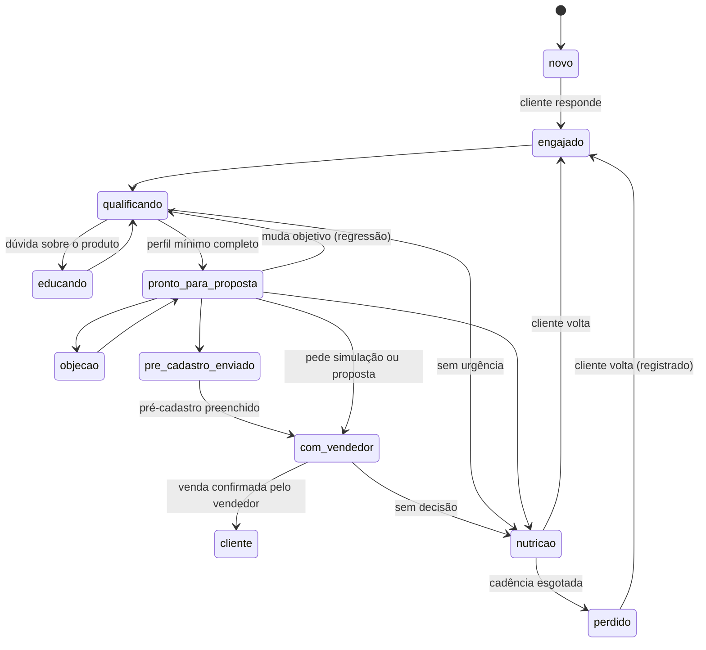

# 13 — Pacotes de segmento

Tudo o que é específico de um tipo de venda vive num **pacote versionado**. O núcleo conhece só as interfaces abaixo. Critério de aceite: o teste `tests/contract/test_segment_agnostic.py` varre **todo** `src/agentplatform/` (núcleo, `api`, `jobs`, `lab`, templates do console e `prompts/` do núcleo), exceto `packages/`, com o glossário de cada pacote instalado + uma lista fixa (`cons[oó]rci`, `contempla`, `\blances?\b`, `\bcotas?\b`, `assembleia`, `prestamista`, `carta de cr[eé]dito`), e devolve zero ocorrências (revisão #21), e o pacote fictício `auto_insurance` passa na suíte genérica (`tests/contract/test_segment_package.py`).

## 1. Contrato do pacote

Formato (ADR-013): um pacote Python instalável (`packages/<name>/`), registrado por entry point `agent_platform.segment_packages`, com dados em YAML validados por Pydantic no carregamento.

```python
class SegmentPackage(Protocol):
    name: str                       # 'consortium'
    version: str                    # semver; tenant pins a version
    def manifest(self) -> PackageManifest: ...
    def tools(self) -> list[ToolSpec]: ...                 # domain tools (plugin interface)
    def dataset_schemas(self) -> dict[str, type[BaseModel]]: ...
    def lead_profile_model(self) -> type[BaseModel]: ...   # slots
    def lead_form_model(self) -> type[BaseModel]: ...      # pre-registration fields
    def eval_assets(self) -> EvalAssets: ...               # datasets and scenarios paths

class PackageManifest(BaseModel):
    glossary: dict[str, str]
    persona_defaults: PersonaConfig
    slots: list[SlotSpec]                     # name, type, question, required_for: [stages], validators
    qualification_questions: list[QuestionSpec]
    stages: list[StageSpec]                   # goal, guidelines, priority_questions, exit_criteria, max_turns_without_progress, is_terminal
    transitions: list[TransitionSpec]         # from, to, trigger, regression: bool
    initial_stage: str; opt_out_stage: str; form_stage: str; seller_stage: str; won_stage: str
    min_profile_for_proposal: ProfileRule     # boolean expression over slots
    flows: list[FlowSpec]                     # declarative sales steps
    guidelines: list[GuidelineSpec]           # condition -> action, priority, stages
    intents: list[IntentSpec]; objections: list[ObjectionSpec]
    handoff_triggers: list[HandoffTriggerSpec]
    compliance: ComplianceRules               # forbidden_phrases, required_disclosures, never_request, numeric_rules
    knowledge_sources: list[KnowledgeSourceSpec]
    faqs_seed: list[FaqSpec]
    followup_cadences: list[CadenceSpec]
    key_facts: list[KeyFactSpec]              # facts to cross-check across documents
```

**Sobrescrita pelo tenant:** tudo pode ser sobrescrito na config do tenant (`08`), **menos compliance, que só pode ficar mais restritivo**. O validador de config faz o merge e verifica a monotonicidade: `forbidden_phrases` e `never_request` só crescem, `required_disclosures` só crescem, `numeric_rules` não podem ser removidas e limiares de risco não podem baixar. Violação → a config é rejeitada na publicação.

## 2. Pacote `consortium` (v0.1.0)

### 2.1 Glossário e persona

- Glossário: carta de crédito, cota, grupo, assembleia, contemplação, sorteio, lance (livre, fixo, limitado, embutido), taxa de administração, fundo de reserva, seguro prestamista, reajuste (INCC/IPCA, conforme o plano), parcela, prazo.
- Persona padrão: "assistente virtual de {{seller_name}}, consultor(a)"; tom próximo e didático, sem jargão na primeira mensagem, uma pergunta por vez.

### 2.2 Slots do perfil do lead

| Slot | Tipo | Pergunta-base | Obrigatório para |
| --- | --- | --- | --- |
| `goal` | enum `real_estate`, `vehicle`, `heavy_vehicle`, `services`, `other_movable` | "Você está pensando em imóvel, carro, moto, caminhão ou outro objetivo?" | `pronto_para_proposta` |
| `credit_amount` | money (BRL) | "Mais ou menos de quanto seria o valor do bem?" | um de `credit_amount` / `monthly_budget` |
| `monthly_budget` | money (BRL) | "Qual parcela caberia no seu bolso hoje?" | idem |
| `term_months` | int ou faixa | "Você tem um prazo em mente?" | `pronto_para_proposta` (aproximado) |
| `has_bid_funds` | bool + money opcional | "Você teria algum valor guardado para ofertar lance?" | não |
| `urgency` | enum `now`, `months_3_12`, `over_12`, `no_rush` | "Para quando você precisa do bem?" | não |
| `city` | text | "De qual cidade você fala?" | pré-cadastro |
| `first_name` | text | — (do perfil do Instagram ou perguntado) | pré-cadastro |
| `is_existing_customer` | bool | inferido | gatilho de pós-venda |

`min_profile_for_proposal = goal AND (credit_amount OR monthly_budget) AND term_months`.

### 2.3 Estágios e transições



**Estágio ≠ posse:** o estágio diz em que ponto da venda o lead está; a posse (`05` §5) diz quem fala. `com_vendedor` não silencia o bot. Se a posse voltar para `BOT` (vendedor devolveu), o bot atende com a diretriz de apoio ("o {{seller}} está cuidando da sua proposta; posso tirar dúvidas enquanto isso"), sem refazer a qualificação.

- `opt_out` é alcançável de qualquer estágio e é terminal para mensagens ativas.
- `cliente` só é marcado pelo vendedor (console ou botão no aviso). `com_vendedor` é marcado pelo handoff de lead quente.
- Estágio `simulado` (entre `qualificando` e `pronto_para_proposta`) entra **só quando houver tabela oficial** (feature flag `consortium.simulation_enabled`).

| Estágio | Objetivo | Ferramentas liberadas | Sem progresso (turnos) |
| --- | --- | --- | --- |
| `novo` | Obter a primeira resposta | núcleo | 2 |
| `engajado` | Entender o objetivo | núcleo | 3 |
| `qualificando` | Preencher o perfil mínimo | núcleo (+ `simulate_consortium` se ligada) | 5 |
| `educando` | Tirar dúvidas com base aprovada | núcleo, `group_history` (se ligada) | 4 |
| `pronto_para_proposta` | Fechar o próximo passo (pré-cadastro ou vendedor) | núcleo, `create_lead_form_link` | 3 |
| `objecao` | Tratar a objeção com texto aprovado | núcleo | 3 |
| `pre_cadastro_enviado` | Lembrar do formulário (dentro da janela) | núcleo | 2 |
| `com_vendedor` | Apoio enquanto o vendedor negocia (o silêncio vem da posse, não do estágio) | núcleo | — |
| `nutricao` | Follow-up leve | núcleo | — |
| `cliente`, `perdido`, `opt_out` | Terminais | — | — |

### 2.4 Ferramentas de domínio

```python
class SimulateConsortiumIn(BaseModel):
    goal: Goal; credit_amount: Decimal | None = None; monthly_budget: Decimal | None = None
    term_months: int | None = None; bid_percent: Decimal | None = None

class SimulateConsortiumOut(BaseModel):
    options: list[PlanOption]        # each with plan_id, credit, term, installment, admin_fee_pct, reserve_fund_pct, insurance_note
    dataset_id: UUID; dataset_version: int
    disclaimer_key: str = "simulation_estimate"   # required disclosure
```

- `simulate_consortium`: leitura determinística sobre `domain_rows` do dataset `plans` (fórmula do regulamento implementada em código, testada com casos do cliente). **Desligada até existir tabela oficial**; enquanto isso, pedido de simulação → handoff `simulation_request`.
- `group_history`: agregados por grupo e período (faixa de lance contemplado, número de observações, data), sempre com o texto "histórico, não garante resultado futuro". **Desligada até aprovação do cliente**; nunca ranqueia grupos por "contempla mais rápido".

### 2.5 Fluxo de venda (declarativo)

```yaml
flows:
  - id: qualify_then_next_step
    steps:
      - id: goal          ; collect: [goal]
      - id: amount        ; collect_any: [credit_amount, monthly_budget]
      - id: term          ; collect: [term_months]
      - id: bid_and_urgency ; collect_optional: [has_bid_funds, urgency]
      - id: next_step
        branch:
          - when: "simulation_enabled"       ; do: tool:simulate_consortium
          - when: "not simulation_enabled"   ; do: offer_seller_or_form
      - id: close ; do: create_lead_form_link | request_human(hot_lead)
```

### 2.6 Diretrizes condicionais (amostra do catálogo)

| id | Condição | Ação | Estágios |
| --- | --- | --- | --- |
| `bid_question` | cliente pergunta sobre lance | Explicar lance livre, fixo e embutido com base aprovada; nunca prometer contemplação; oferecer o vendedor para regras do grupo | `educando`, `qualificando` |
| `vs_financing` | compara com financiamento | Usar só o texto aprovado `faq:vs_financing`; sem números próprios | todos |
| `wants_fast` | quer o bem "rápido" ou "já" | Explicar que a contemplação é por sorteio ou lance, sem prazo garantido; perguntar sobre recurso para lance | todos |
| `insurance_question` | pergunta sobre seguro | Só o que está no material aprovado; regras no contrato do grupo | todos |
| `post_sale` | cliente atual com boleto, assembleia, contemplação | Handoff `post_sale` | todos |
| `asks_cpf` | o cliente oferece CPF ou renda | Agradecer e dizer que não precisa por aqui; não repetir o dado | todos |

### 2.7 Gatilhos de handoff do pacote

`simulation_request` (sem tabela), `post_sale`, `cancellation`, `legal`, `requires_sensitive_data` (CPF, renda, saúde), `credit_above_threshold` (configurável, padrão R$ 500 mil), `hot_lead` (pré-cadastro preenchido ou pede proposta).

### 2.8 Compliance do pacote

```yaml
compliance:
  forbidden_phrases:            # regex + semantic (similarity >= 0.85)
    - "contempla(ção|do) garantid"
    - "garant\\w+ (a |de )?contempla"
    -
    - "aprova(ção|do) garantid"
    - "(em|no) (\\d+|poucos) (dias|meses) você (é|será|vai ser) contemplad"
    - "grupo que (mais )?contempla (mais )?rápido"
    - "sem juros"               # allowed only via approved FAQ text that cites admin fee/reserve fund/readjustment
    - "comiss(ão|ões)"
  required_disclosures:
    simulation_estimate: "Valores estimados com base na tabela vigente. As condições finais constam no contrato e no regulamento do grupo."
    history_not_guarantee: "Isso é histórico de assembleias anteriores e não garante resultado futuro."
  never_request: [cpf, rg, income, assets, bank_data, health_data]
  numeric_rules:
    product_numbers_require_provenance: true     # installment, rate, term, bid %, credit
  internal_documents_never_cited: true
  contracting_only_in_official_system: true
```

### 2.9 Conhecimento, FAQs e cadências

- Fontes: o material aprovado de cada conta; o inventário fica com o material (ADR-023).
- FAQs semente (redigidas no fim da fase 1 e aprovadas pelo cliente): o que é consórcio; como funciona a contemplação; tipos de lance; o que é taxa de administração e fundo de reserva; seguro prestamista (obrigatoriedade, outra seguradora, DPS); consórcio × financiamento (texto aprovado); como funciona a liberação do crédito; quem é o consultor.
- Cadências (mesmos ids e regras do `09` §2): `form_not_filled` (1 lembrete 4 h depois de entrar em `pre_cadastro_enviado`, dentro da janela e do horário), `no_reply_after_answer` (1 lembrete 3 h depois de uma pergunta do bot sem resposta, dentro da janela) e `nutricao` (fase 4, com WhatsApp e consentimento).

### 2.10 Avaliação do pacote

Datasets `consortium/understand-v1` (50 mensagens rotuladas com slots e estágio), `consortium/rag-v1` (60 perguntas), `consortium/scenarios-v1` (20 cenários multi-turno com persona: indeciso, quer garantia de contemplação, compara com financiamento, só manda áudio, pede humano, injection, pós-venda, opt-out no meio).

## 3. Pacote fictício `auto_insurance` (teste de abstração)

Existe só em `packages/agentplatform_packages/auto_insurance` e em testes, para provar que o núcleo é genérico:

- Slots: `vehicle_model`, `vehicle_year`, `zip_code`, `main_driver_age_band`, `current_insurer`.
- Estágios: `new → engaged → quoting → quote_ready → with_broker → won | lost`, mais `opt_out`.
- Ferramenta de domínio: `estimate_premium` (tabela fictícia, determinística).
- Compliance: `forbidden_phrases: ["cobertura total garantida"]`, `never_request: [cpf, driver_license_number]`.
- Suíte genérica (`tests/contract/`): carrega o pacote, valida o manifesto, roda 10 cenários de fluxo com `FakeChannelAdapter` e LLM gravado (cassette), e checa transições, perfil mínimo, guard numérico e handoff. **O mesmo arquivo de teste roda para `consortium` e `auto_insurance`.**
